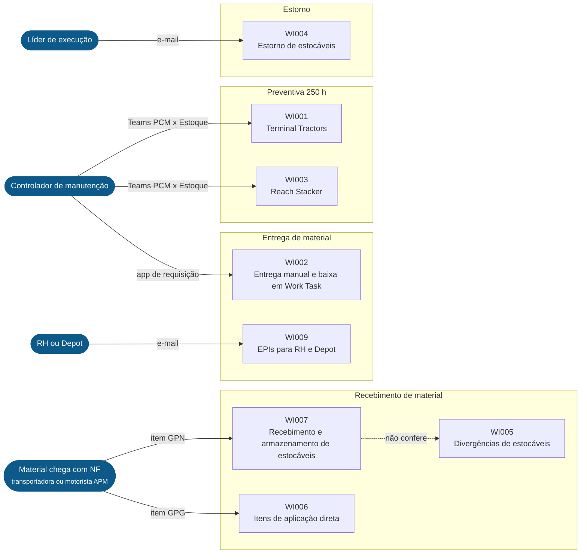
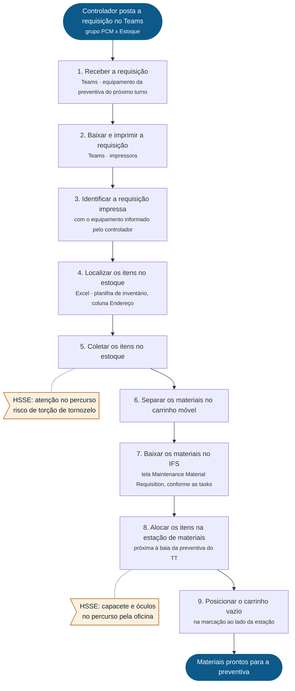
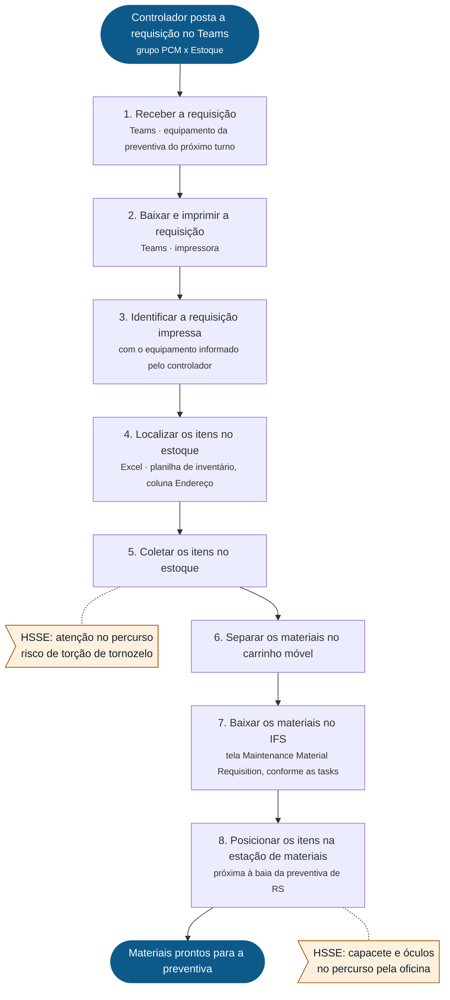
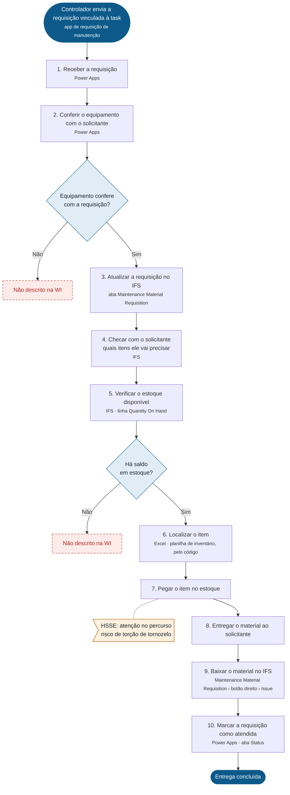
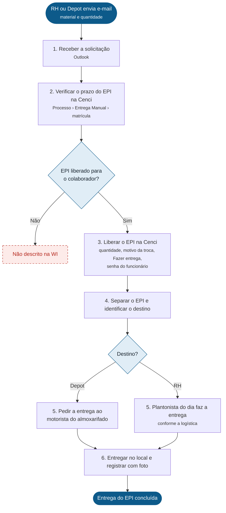
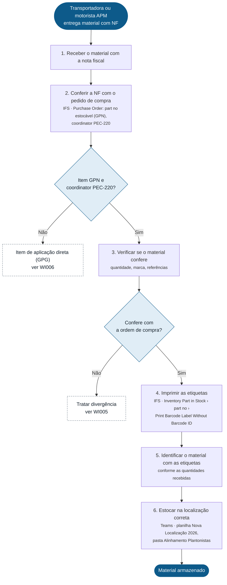
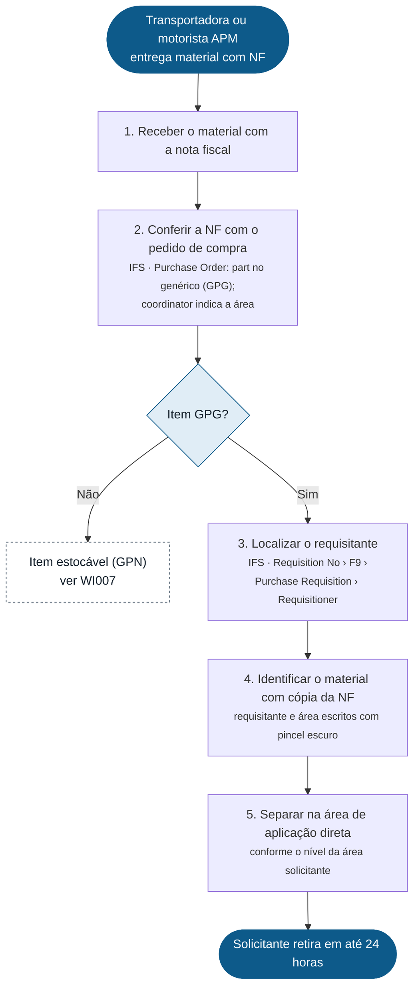
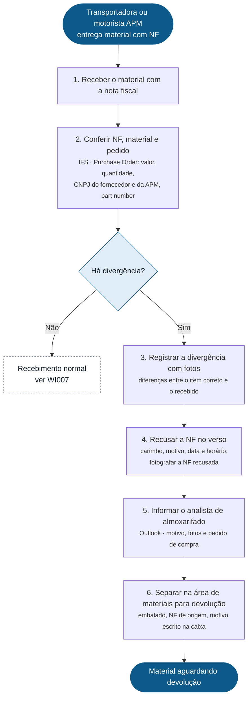
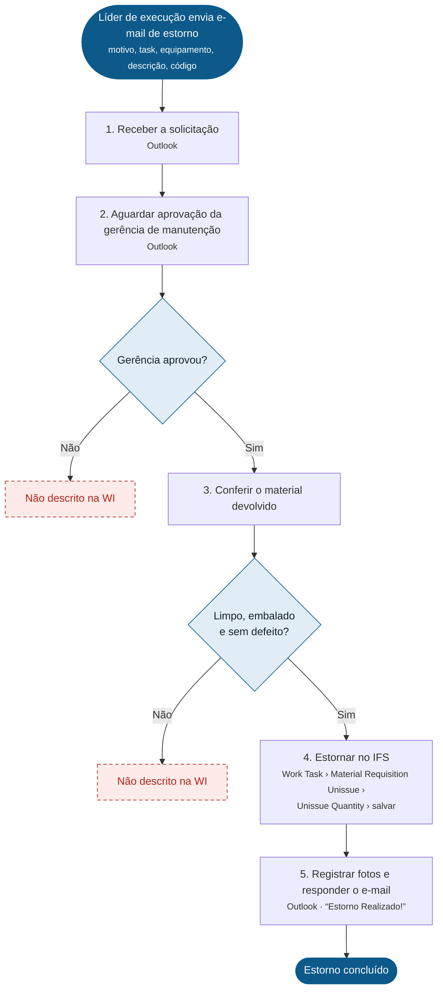

# Fluxos do Almoxarifado PEC

Fluxogramas desenhados a partir das Work Instructions aprovadas do Almoxarifado (BRPEC-WH-WHA). Versão executiva interativa (nota de consistência, matriz de inconsistências, achados e raio-X em raias): `index.html`.

Legenda: azul cheio = início/fim · losango = decisão · laranja = ponto de HSSE · vermelho tracejado = lacuna (a WI não diz) · cinza tracejado = ligação com outra WI.

## Mapa das WIs

- **Nota:** Clique numa WI à esquerda para ver o fluxo dela. As setas tracejadas mostram onde uma WI leva a outra.
- **Lacuna:** A WI008 não está no PDF. A numeração pula de WI007 para WI009.
- **Revisar:** As ligações entre WIs (WI007 → WI005, WI007 ↔ WI006) foram deduzidas do conteúdo. Nenhuma WI cita outra no campo Related doc.

## WI001 · Separação de Materiais de Preventivas de 250 h de Terminal Tractors

**Versão:** 2.0 · **Emissão:** 12/03/2026 · **Processo:** Preventiva · **Criação:** Zenaide Ellen · **Aprovação:** Bruno Abreu · **HSSE:** Ticiana Ferreira

- **Lacuna:** Não diz o que fazer se um item da requisição faltar no estoque ou se o endereço da planilha estiver errado.
- **Revisar:** Só a WI001 tem a etapa 9 (devolver o carrinho vazio). A WI003, que é o mesmo processo para Reach Stacker, termina na etapa 8.
- **Revisar:** Erros de digitação: “Posicinar/Posicine”, “tosão de tornozelo”, “Requistion”.

## WI003 · Separação de Itens de Preventivas de 250 h de Reach Stacker

**Versão:** 1.0 · **Emissão:** 10/06/2026 · **Processo:** Preventiva · **Criação:** Zenaide Ellen · **Aprovação:** Bruno Abreu · **HSSE:** Ticiana Ferreira

- **Lacuna:** Não diz o que fazer se um item da requisição faltar no estoque.
- **Revisar:** Falta a etapa de devolver o carrinho vazio, que existe na WI001 (etapa 9).
- **Revisar:** Na etapa 3 o texto “Localizar os itens no estoque” ficou colado no fim (“teamsLocalizar”).

## WI002 · Entrega Manual e Baixa de Materiais Inventariados em uma Work Task

**Versão:** 1.0 · **Emissão:** 22/01/2026 · **Processo:** Entrega de Material · **Criação:** Turma 2026.1 · **Aprovação:** Italo da Silva · **HSSE:** Ticiana Ferreira

- **Lacuna:** Etapa 2: não diz o que fazer se o equipamento não bater com a requisição.
- **Lacuna:** Etapa 5: não diz o que fazer se o Quantity On Hand estiver zerado ou abaixo do pedido.
- **Revisar:** O campo Creator está como “Turma 2026.1”, não como uma pessoa responsável.
- **Revisar:** Erro de digitação: “tosão de tornozelo”.

## WI009 · Separação de EPIs Solicitados pelo RH e Depot

**Versão:** 1.0 · **Emissão:** 04/08/2026 · **Processo:** Entrega de Material · **Criação:** Zenaide Ellen · **Aprovação:** Raphael Santos · **HSSE:** não preenchido

- **Lacuna:** Etapa 2: não diz o que fazer se o EPI ainda não estiver liberado para o colaborador pelo prazo do HSSE.
- **Lacuna:** Etapa 6: não diz onde a foto da entrega deve ser registrada ou enviada.
- **Revisar:** O campo HSSE está vazio no cabeçalho.
- **Revisar:** Erros de digitação: “Verique”, “fazer entregar”, “disponivel”.

## WI007 · Recebimento e Armazenamento de Materiais Estocáveis

**Versão:** 1.0 · **Emissão:** 14/07/2026 · **Processo:** Recebimento de Material · **Criação:** Zenaide Ellen · **Aprovação:** Italo da Silva · **HSSE:** não preenchido

- **Revisar:** As saídas para a WI005 (divergência) e para a WI006 (item GPG) são deduções minhas. A WI007 não diz o que fazer quando a conferência falha.
- **Lacuna:** Etapa 6: não diz o que fazer se o item não tiver localização na planilha Nova Localização 2026.
- **Revisar:** No PDF as etapas 5 e 6 estão sem número. O campo HSSE está vazio.

## WI006 · Identificação e Separação de Itens de Aplicação Direta

**Versão:** 1.0 · **Emissão:** 10/07/2026 · **Processo:** Separação de Material · **Criação:** Zenaide Ellen · **Aprovação:** Italo da Silva · **HSSE:** não preenchido

- **Lacuna:** Não diz o que acontece se o solicitante não retirar o material em 24 horas.
- **Revisar:** A saída para a WI007 (item GPN) é dedução minha. A WI006 não diz o que fazer se o part no não for GPG.
- **Revisar:** O campo HSSE está vazio no cabeçalho.

## WI005 · Tratativas de Divergências de Materiais Estocáveis

**Versão:** 1.0 · **Emissão:** 30/06/2026 · **Processo:** Recebimento de Material · **Criação:** Zenaide Ellen · **Aprovação:** Italo da Silva · **HSSE:** não preenchido

- **Lacuna:** Não diz quem retira o material da área de devolução nem em quanto tempo.
- **Revisar:** A saída “sem divergência → WI007” é dedução minha, para fechar o fluxo.
- **Revisar:** No PDF as etapas 5 e 6 estão sem número. O campo HSSE está vazio.

## WI004 · Processo de Estorno de Materiais Estocáveis

**Versão:** 1.0 · **Emissão:** 17/06/2026 · **Processo:** Estorno de Material · **Criação:** Zenaide Ellen · **Aprovação:** Felipe Marques · **HSSE:** não preenchido

- **Lacuna:** Etapa 2: não diz o que fazer se a gerência de manutenção não aprovar o estorno.
- **Lacuna:** Etapa 3: não diz o que fazer se o material voltar sujo, sem embalagem ou com defeito.
- **Lacuna:** Não diz onde guardar fisicamente o material estornado depois do lançamento no IFS.
- **Revisar:** O campo HSSE está vazio no cabeçalho.
